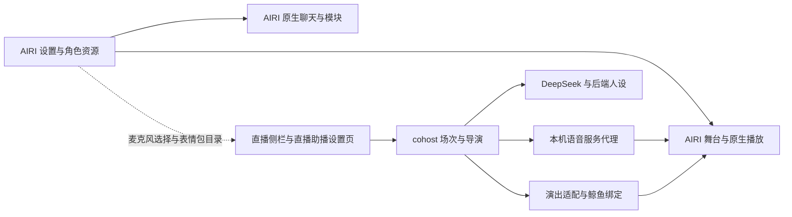

# AIRI 与直播助播整合审计

日期：2026-10-14。

范围：本机固定 AIRI 版本 `34576c19f618a04e616657089f0688a8637873f2` 与当前补丁。按应用、共享包、设置、状态存储、直播后端和执行通道核对。不是上游最新版评测，也不是所有功能的真人验收。

## 结论

目前是“AIRI 舞台 + 独立直播引擎 + 多条适配通道”。上一轮统一了设置入口，没有统一所有设置的作用范围。

AIRI 原生聊天与直播助播各自拥有模型、人设、语音配置和历史。用户在同一个 AIRI 设置界面能看到两套配置，但无法判断哪些控制直播。

目标：AIRI 提供日常配置入口和角色资源，直播后端保留导演与场次控制。每项配置只有一个维护来源。后端和舞台返回实际采用的版本，界面据此显示生效状态。

## 当前结构

- `apps/stage-tamagotchi`：Electron 主进程、舞台窗口、独立设置窗口。
- `apps/stage-web`：网页入口，复用共享组件，浏览器资料与桌面资料分开。
- `packages/stage-pages`、`stage-layouts`、`ui`、`i18n`：页面、布局、控件与翻译。
- `packages/stage-ui`：Pinia 配置、角色卡、供应商、原生聊天、收音与舞台调度。
- `packages/stage-ui-live2d`、`stage-ui-three`、`stage-ui-mmd`：不同模型渲染与控制。
- `packages/pipelines-audio`：分句、合成队列、播放与取消。
- `apps/cohost`：直播事件、弹幕、导演、已交付对话、语音代理、演出命令。
- `integrations/airi` 与 `scripts/patch-*.mjs`：可重放适配。`vendor/airi` 不是修改的唯一副本。
- AIRI 另有移动端、账号后端、插件通道及游戏/社交模块。本地直播不依赖这些模块全部启用。

## 功能与设置对照

| 用户操作 | 对当前直播的实际作用 | 缺口与目标 |
| --- | --- | --- |
| 角色卡编辑、选择 | 原生卡能应用形象与原生模块选择。直播人格仍从 `xiaojingyu.md` 启动加载 | 原生选中卡成为直播人格来源，导演与回复同版本。首次迁移保留原卡与小鲸鱼文本 |
| 意识/聊天供应商、模型、温度 | 控制原生聊天。直播直接请求 DeepSeek，模型由后端环境配置指定 | 把本机代理注册为 AIRI 可识别的直播服务，统一可编辑配置与实际状态 |
| 形象选择、位置、缩放、帧率、渲染比例 | 已共用原生舞台设置 | 后端动作目录仍固定鲸鱼。切换其他模型必须同步能力并废弃旧动作 |
| 原生表情预览、保存默认值 | 确实修改运行中的原生表情 store | 人工预览与 AI 演出需要统一互斥、恢复和默认值规则 |
| 表情“公开给 LLM” | AIRI store 有 none/all/custom；直播演出没有读取它 | 权限同时约束模型可见目录与执行端。关闭后不能通过别名或组件绕过 |
| 自主组件动作、摇尾巴 | 通过本项目 `RigController`、组件白名单和时序执行 | 当前是鲸鱼专用绑定。需要独立的组件控制开关和实际模型能力目录 |
| 眼神跟随鼠标 | 舞台初始化适配中强制关闭，符合此前用户要求 | 改成原生设置的一次默认迁移，后续尊重用户在界面的更改 |
| 麦克风设备 | 已读取原生选择，下次开麦生效；录音流仍独立管理 | 换设备真人验收；显示当前使用设备与待应用选择 |
| 原生识别供应商、自动发送等待 | 原生页面控制原生识别路径；直播调用固定 SenseVoice，并自设 650ms 静音分段 | 把有效识别配置与分段参数纳入统一设置；不要再让测试页与直播使用两套参数 |
| 原生语音合成供应商、音色 | 直播的 `cohost:` 请求被舞台分流到本机后端，绕过原生供应商选择 | 本机 Index/Aqua 与云端 Qwen 等通过统一适配展示。保持服务密钥仅本机环境文件 |
| 原生分句、播放、取消、口型 | 已复用音频流水线和舞台 AudioContext，含本项目流式补丁 | 保留已验证的取消、过期音频隔离与首声路径，不另开第二套播放队列 |
| 聊天表情包开关、频率、素材 | 自动导演路径已读取原生库元数据，并在本地按 ID 显图 | 人工回复未接选图。桌面/网页图库不同，不能把元数据同步当成素材同步 |
| 聊天记录、导出、删除 | AIRI 操作原生 chat session；直播气泡来自 RoomJournal | 提供直播记录的数据入口，明确删除和恢复范围 |
| 记忆页面 | 当前固定版本的记忆、短期、长期设置页是 WIP；直播自带有限上下文 | 气泡恢复不恢复模型 history/Scene。不要向用户承诺长期记忆已共用 |
| 视觉、屏幕、MCP、搜索 | 原生聊天有对应模块/工具解析；直播请求没有接入它们 | 暂不为“整合”全部打开。直播界面明确标注作用范围，按真实需求逐个接入 |
| B站弹幕 | 本机 cohost 接收 blivechat/官方来源，原生设置页只是入口 | 这是直播专属能力，保留在直播模块，实际开播验收仍未完成 |
| 重置模块、导出设置 | AIRI 维护自己的 stores、模型与会话，不统一管理后端 `.env` 和场次 | 明确范围，避免“重置了但直播没变”；凭据不进入普通导出 |
| 桌面启动、打包 | 当前开发版；部分适配用端口 5174 判断直播模式 | 正式入口改成显式运行模式与版本握手，再验证固定构建启动 |

## 已确认的关键问题

### P1：表情授权开关没有执行约束

`expression-store.ts` 提供 `isExposedToLlm`，但直播 `RigController` 没有使用它。后端 `performance-prompt.mjs` 直接拼接鲸鱼完整白名单。界面的“无”不会禁止直播模型选表情。

“LLM 工具集成尚未接入”是原生固定提示。仓库有 `expressionTools` 定义，但本次搜索未找到它接入原生聊天工具解析的调用。我们的直播通过另一条路径执行动作。不能只改提示，宣称原生工具和权限已打通。

暴露模式与逐项选择当前只在内存 ref/Map 中。`saveDefaults` 保存参数值，不保存这些权限；模型 dispose 会重置权限。

### P1：两套人设与供应商配置

原生卡的 `systemPrompt` 来自系统提示、描述、性格和场景。直播的 `SYSTEM_PROMPT` 从固定文件读取。两条生成路径都引用该常量，原生卡编辑不会更新它。

直播状态中的人格名称也写死为“小鲸鱼”。只同步显示名称不能证明模型真的采用了角色卡内容。

### P1：设置与实际音频路径不一致

直播复用了收音与合成的部分底层能力，但固定选择 SenseVoice，并通过本机代理生成声音。原生语音供应商页里的配置并非直播配置。当前链接到“麦克风与识别设置”尤其容易让用户误判识别服务也已同步。

### P2：默认表情保存与临时演出冲突

AI 演出临时写入同一个 expression store。原生 `saveDefaults` 将当前值写成持久默认值，没有区分 AI 临时写入。若在演出中保存，存在把临时表情保存成默认脸的风险。此项为代码推断，未破坏用户默认值进行复现。

人工 `toggle` 不经过本项目脸部/手势互斥处理。AI 路径已有互斥，不代表人工同时打开多个眼型也安全。此项仍需隔离场景验证。

### P2：界面历史与模型记忆分离且提示不足

`RoomJournal` 可恢复气泡；`histories` 和 `Scene` 仍在后端启动时创建为空。恢复聊天截图不代表小鲸鱼记得这些对话。原生会话导出也不包含这些数据。

## 统一方案与开发顺序

### 第一阶段：角色与表演设置闭环

1. 复用 AIRI 原生角色卡编辑器。迁移小鲸鱼文本为可编辑角色卡，不覆盖现有 ReLU 或自定义卡。
2. 由活动舞台发布选中角色的已保存人格快照。导演与回复在每轮开始采用同一版本，进行中的回复不混用新旧人格。
3. 暴露当前模型真正存在且允许的表情。权限按模型持久化，并在舞台执行前再次检查。
4. 显示“已生效/等待应用/未连接”。切换模型、关闭权限后，旧版本命令失效。
5. 将人工预览、AI 演出和保存默认值接入同一参数所有权规则。保存默认值前排除临时演出层。

验收：编辑角色卡后下一轮采用新性格；重启保留。none 禁止命名表情，custom 只允许选中项；别名和重叠组件不能绕过。手动预览仍可用，换模型不执行旧绑定。进行演出时保存默认值不固化临时脸。

### 第二阶段：语音与模型配置闭环

1. 把现有本机语音代理接为 AIRI 模块适配器，保留现有后端鉴权与取消语义。
2. 识别测试页与直播读取同一设备、识别模型和分段配置。声音试听与直播读取同一合成配置。
3. 原生设置显示当前直播所用模型/服务。不能支持的选项明确禁用或说明范围。
4. 保留 `.env` 密钥边界，不将其复制进角色卡、浏览器存储或聊天导出。

验收：在界面切换音色后，试听与真实回复一致；换麦克风后实际设备一致；关麦文字输入仍播音；取消后旧音频不恢复。

### 第三阶段：记录与日常运行

1. 让直播记录进入明确的会话/数据管理入口。定义恢复的范围，分开显示历史气泡和模型上下文。
2. 固定桌面构建作为日常入口。开发工具和调试页留在开发入口。
3. 统一配置与状态事件订阅，减少各窗口重复轮询。保留跨窗口单一麦克风与播放所有者。

验收：无需编辑代码或找开发者即可调整人格、表演权限、输入设备、声音与模型。重启、断线、双窗口均显示真实有效配置。

## 延迟与实施约束

- 复用现有 Pinia/Eventa 和本机服务，不为设置同步引入 MCP 或第二个推理模型。
- 配置变化时同步版本化快照，生成时读取本地已确认快照，不串行等待一次远程设置查询。
- 保留当前导演一次调用同时做决定与拟定发言的路径。
- 表演能力仅发送当前模型的允许项，不把所有角色资源、整个设置树或图片字节塞入提示词。
- 配置按实际活动舞台选择，解决桌面与网页同时打开时的人格/权限竞争。
- 不为了统一界面重写已经验证的语音取消与播放链路。每阶段单独回归。

## 代码依据

- [原生角色卡与系统提示](../vendor/airi/packages/stage-ui/src/stores/modules/airi-card.ts)、[直播固定人格](../apps/cohost/deepseek.mjs)、[参与模型](../apps/cohost/participation-model.mjs)。
- [原生表情状态与权限](../vendor/airi/packages/stage-ui-live2d/src/stores/expression-store.ts)、[原生设置提示](../vendor/airi/packages/stage-ui/src/components/scenarios/settings/model-settings/live2d.vue)、[原生工具定义](../vendor/airi/packages/stage-ui-live2d/src/tools/expression-tools.ts)。
- [直播演出绑定](../integrations/airi/rig-controller.ts)、[舞台控制](../integrations/airi/use-cohost-performance.ts)、[固定能力提示](../apps/cohost/performance-prompt.mjs)。
- [直播语音适配](../integrations/airi/use-cohost-voice.ts)、[原生舞台播放](../vendor/airi/packages/stage-ui/src/components/scenes/Stage.vue)、[直播声音服务](../apps/cohost/speech-output.mjs)。
- [直播侧栏与表情包同步](../integrations/airi/cohost-panel.vue)、[表情包目录](../apps/cohost/stickers.mjs)、[直播设置页](../integrations/airi/cohost-settings.vue)。
- [后端与对话历史](../apps/cohost/server.mjs)、[气泡快照](../apps/cohost/room-journal.mjs)、[现场上下文](../apps/cohost/scene.mjs)、[原生数据维护](../vendor/airi/packages/stage-ui/src/composables/use-data-maintenance.ts)。
- [原生聊天工具解析](../vendor/airi/packages/stage-ui/src/stores/ai/chat-llm/tool-resolver.ts)、[记忆页面占位](../vendor/airi/packages/stage-pages/src/pages/settings/memory/index.vue)。
- [桌面启动](../scripts/desktop.mjs)、[可重放设置补丁](../scripts/patch-console.mjs)。

本轮完成源码结构审计与开发顺序整理，没有修改运行逻辑、用户配置或密钥。现有测试结果见 STATUS；不把旧测试结果当作以上缺口已经修复的证据。

## 2026-10-14 角色卡与表情权限修复

- 在“直播助播”中迁移/选择小鲸鱼卡或绑定当前角色卡。编辑入口：AIRI角色卡 → 小鲸鱼铅笔 → 行为 → 性格 → 保存更改。保存后设置页显示同步状态。原有卡保留；迁移仅将有服务商却无模型的不完整覆盖改为继承，避免原生保存校验失败。
- 导演与文字回复使用原生组合人格提示。桌面心跳优先于网页，30秒未上报则能力失效，人格保留最后值；后端重启后由舞台重新同步。卡的模型/语音覆盖、问候语及原生聊天工具尚未统一到直播。
- 角色模型 → 表情 → 公开给LLM：无禁止命名表情/组件，全部允许可用鲸鱼表情及组件，自定义只允许选中的命名表情。普通头身姿态独立。权限按模型持久化；提示及执行两端限制，AI临时表情不污染保存默认值。
- 真实Electron编辑保存、主窗口同步、后端人格指纹匹配及恢复原文通过。表情全部权限刷新保留通过。check和172项原型测试、2项原生权限测试通过；相关包类型检查通过，最后修改组件lint通过。全仓检查仍存在STATUS列出的依赖阻挡。没有增加模型调用，也未改动Index服务。
- 源码在 integrations/airi、apps/cohost/runtime-profile.mjs；scripts/patch-character.mjs由patch-console调用，修改可重放。
