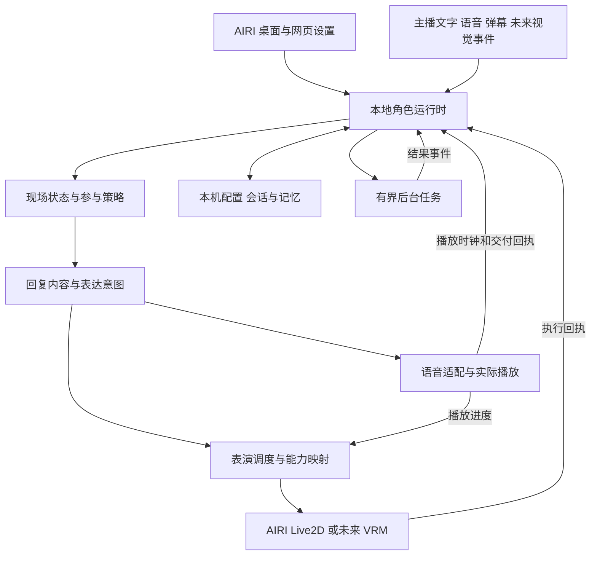

# 小鲸鱼长期架构与迁移路线

初稿：2026-10-14；收尾：2026-10-15。当前实现、验收和范围调整见 [架构升级验收](ARCHITECTURE-ACCEPTANCE.md)，部署版本见 [STATUS](STATUS.md)。下文保留设计依据与历批记录，不把历史“下一步”当作当前待办。

2026-10-17 当前改进顺序见[自然聊天改进计划](STREAMING-LISTENING.md#2026-10-17-自然聊天改进计划)：同版本音频基线 → 统一话轮与播放状态 → 附和/接管协调 → 跨分段增量理解 → 首声与场次一致性。该计划待实施，不改变下方历史验收事实。

## 决策

保留 AIRI 桌面与网页、原生设置和角色渲染。将直播引擎整理成模块化的本地角色运行时，统一配置、话轮、交付记录和能力接口。实时语音优先复用现有链路及成熟组件，按真实缺口替换。现阶段不整体迁入 Cortico、Amadeus、Pipecat 或 LiveKit，不接入 SoulLink，也不将 VRM 实装列为当前前置任务。

这不是保留全部旧代码。需要逐步替换的包括：界面挂载决定服务生命周期、按端口识别舞台、状态轮询兼任命令调度、两套配置写入、鲸鱼参数进入通用后端，以及不能恢复上下文的记录存储。

架构的检验标准：新增一种模型、声音或事件来源时，能否主要修改适配层，并保住接话、打断、记忆和设置的一致性。增加模块数量、模型调用数或自主循环数都不算进步。

## 目标与约束

- 真人主播主导，中文闲聊和知识分享。小鲸鱼能自然接话、接梗、回应部分弹幕、适时主动参与，也能安静倾听。
- 桌面是日常入口，网页备用。当前使用 Live2D，未来允许 VRM、视觉和工具等扩展。
- 声音清楚、音色满意、语气恰当与低延迟并重。表演有连续性，但动作不得拖住开口。
- 用户能从 AIRI 设置完成日常配置，知道当前实际采用什么、何时生效、为何不可用。
- 用户已放宽开发预算，优先长期效果和效率。运行时仍限制无效推理、无限上下文和重复工作，避免降低响应性。
- 本机开发和本机数据优先。密钥仍只在忽略的 `.env`，普通设置和诊断导出不包含密钥。
- 当前不要求游戏操作、通用上网、多人视频房间、插件市场、云端集群或全自主常驻任务。
- SoulLink 是架构讨论的例子，用户暂不要求接入。未来模型可替换是设计约束，不代表现在开始换模型。

## 升级前核对的现状（2026-10-14）

以下是本地源码与当前交接的证据，不是本轮重新进行的语音或性能测试。

| 现状 | 依据与影响 |
| --- | --- |
| 调度已有明确边界 | `scheduler.mjs` 有取消、话轮编号、弹幕去重/容量/过期及实际交付前缀；这些行为应保留并进入契约测试 |
| 自动参与已有模型判断与短期意图 | `participation.mjs`、`pending-thought.mjs` 已能准备回复、等待和有限后续参与；不能说当前完全被动或从零没有记忆 |
| 原参与调用等待完整输出 | 原 `participation-model.mjs` 的 `stream:false` 保留用于对照/回退；首句记录流已实现，边界和实际数据见 [首声链路](FIRST-VOICE.md) |
| 场景、可见聊天与模型历史分开 | `scene.mjs`、`room-journal.mjs`、`server.mjs` 分别维护；快照只恢复气泡，不恢复现场和模型历史 |
| 原生角色卡和表情权限首阶段已接通 | `runtime-profile.mjs`、原生设置适配及执行限制已实现；仍靠舞台周期上报，角色选择按桌面心跳优先 |
| 生命周期仍受界面影响 | `cohost-panel.vue` 管理麦克风控制租约和轮询，导航会释放；常驻会话不应依赖侧栏组件存在 |
| 多个协议和配置来源 | HTTP/NDJSON、舞台心跳、演出桥和 AIRI stores 并存；有些必要，但所有权及应用时机不统一 |
| 演出耦合鲸鱼模型 | 后端导入 `whale-rig.ts` 目录，执行器主要面向 Live2D；AIRI 自身已有 VRM，助播尚未适配 |
| 部署仍是开发形态 | 固定 AIRI 提交和可重放补丁有保护价值，但日常启动仍依赖开发构建；全仓依赖检查存在已记录阻挡 |

最近已验证结果为 172 项原型测试、2 项原生权限测试，以及相关包类型和组件 lint 检查。它们不是完整实时交互质量的证明。详细状态见 [STATUS](STATUS.md)。

## 外部方案与取舍

研究范围：公开主仓库、官方文档和部分源码。不将宣传、视频片段、第三方模型跑分当作本机端到端验收。来源访问日期均为 2026-10-14，实施前固定具体版本。

| 方案 | 公开实现或文档提供的价值 | 本项目决策与代价 |
| --- | --- | --- |
| AIRI | 桌面/网页、角色资源、设置、Live2D/VRM 和音频展示基础 | 保留宿主；逐步用明确接口替代补丁式跨层调用。上游功能多不意味着全部已接入直播 |
| Cortico | 事件流、Persona/World 边界、会话持久化、上下文交接和抢占机制 | 借鉴事件与续接语义。整体替换还需证明媒体交付、中文直播参与和现有供应商适配，不能仅因有 memory 接口就视为人格问题已解决 |
| Amadeus | 对话、任务执行和 Host 分工，实时语音与角色呈现的协同 | 借鉴交付回执、后台任务和统一配置。当前主要呈现路线和 Work 系统不是我们整套迁移的直接收益 |
| Pipecat | 可组合音频/文本帧流水线、优先打断、处理器和指标 | 实时媒体候选，存在明确缺口时做隔离适配。引入 Python 流水线不能再留第二个发言调度器 |
| LiveKit Agents | 话轮结束检测、打断策略、错误打断恢复和语音调度 | 借鉴听说分离与语音检测；多端远程实时通信成为真实需求后再评估整体 transport，当前不增加 RTC 基础设施 |
| Open-LLM-VTuber | ASR/Agent/TTS 适配、按句音频处理、角色切换与中断 | 作为实现对照。迁移会重新对接 UI、舞台和直播导演，目前没有已验证的净收益 |
| SoulLink | 可独立使用的本地情绪/表演引擎 | 暂不接入。未来可作为表演驱动候选，不能预设为跨 Live2D/VRM 的公共底座 |

判断：采用 AIRI 加领域明确的角色运行时，当前最符合桌面直播需求。这个选择允许未来替换认知策略或媒体组件。引入成熟模块优于重复实现其通用能力，但必须只有一个负责最终决策与状态的主体。

## 目标结构



首版保留一个本地 Node 控制进程、AIRI Electron 渲染进程和必要的语音推理进程。新边界代码逐步使用 TypeScript，旧 `.mjs` 按功能迁移，不为换语言重写。进程内模块不经过 HTTP 调用；网络接口仅跨真实进程边界。暂不采用服务网格、分布式队列或通用多智能体平台。

目标目录按职责组织，名称可在实施时与现有 workspace 对齐：

```text
apps/cohost/                本地入口、接口和服务组装
packages/contracts/        配置、事件、意图、回执和版本校验
packages/cohost-runtime/   现场状态、话轮、策略、上下文与任务
packages/performance/      表演意图、时钟、控制权和通用限制
adapters/                  AIRI、语音、平台、模型、存储适配
integrations/airi/         迁移期原生 UI 接口和剩余补丁
tests/scenarios/           可重放互动场景与故障用例
```

仅在真正提取功能时创建目录。源码组织不能代替所有权和生命周期设计。

## 配置与会话的唯一归属

| 数据或行为 | 最终归属 | AIRI 的角色 |
| --- | --- | --- |
| 角色身份、人设、选中的运行角色 | 角色运行时的版本化角色仓库 | 保留原生角色卡编辑器，通过仓库适配读写；导入现有卡而非另造编辑器 |
| LLM/ASR/TTS 选择与音色 | 运行时服务配置仓库，密钥只引用本机环境变量名 | 共用原生 provider/module 页面，扩展本地服务条目；试听与直播使用同一快照 |
| 舞台位置、缩放、渲染质量 | AIRI 当前设备/窗口的显示偏好 | 原生直接管理，不把每帧数据同步到后端 |
| 表情授权与模型能力 | 运行时保存授权，当前舞台报告能力；执行端再次检查 | 在角色模型页配置和预览；能力不等于授权 |
| 收音与播放资格 | 运行时签发的设备会话租约 | 根级媒体控制器持有，侧栏只是操作界面 |
| 实际播放位置 | 播放设备/AudioContext | 上报有序回执，不能由后端估算时间代替 |
| 现场事实、已交付对话、待续事项 | 运行时与持久化存储 | 聊天气泡、时间线和设置页是不同视图 |

过渡期先标明每个字段唯一写入方、修订号及适配来源。迁移某个字段时备份并一次导入，旧入口转为同一 repository adapter；不长期双向轮询两个可写副本。原生卡结构中未使用的扩展字段必须往返保留。

2026-10-15 收尾：TTS、当前 DeepSeek/SenseVoice 配置，以及完整角色卡目录/选中角色/绑定状态已进入 SQLite 独立版本仓库；AIRI 原生页面为编辑入口。保存检查修订与现场，事务落盘后发布；模型验证不生成回复。SQL v3 回退需匹配的升级前备份，详见 [普通配置仓库](RUNTIME-SETTINGS.md)。B 站凭据仍用现有本机入口，额外供应商未接入。

每次话轮捕获 `profileRevision`、`configRevision` 和模型能力版本。普通人设修改从下一轮开始，界面显示待应用；权限撤销与显式停止立即生效，旧结果再次校验。配置冲突拒绝覆盖并返回实际版本，不能用最后到达的心跳悄悄决定。

活动舞台按用户选择的租约确定。桌面、网页不能各自重复收音或朗读，设置窗口只编辑。多窗口同时编辑使用版本冲突提示，关闭侧栏和进入设置不能释放正在使用的媒体会话。设备断开才进入明确的暂停/重新选择流程。

长期复用原生设置的目标是同一个页面与同一个服务注册表。原生供应商模块在直播模式下走统一代理；不同模型能力明确标注，不能让 Index 的非标准流假装支持完整 OpenAI TTS 协议。

## 运行状态与交付协议

采用独立但协调的输入、输出和后台任务状态，允许边听边播。不能用一个全局 `busy` 同时表示识别、思考、合成、播放及后台工作。

- 输入：关闭、收听、说话中、等待最终识别。ASR 中间结果带修订号，最终文本去重；声音存在不是接管指令。
- 输出：空闲、生成、合成/缓冲、播放、取消、结束/失败。生成和播放可重叠，不能将“生成完毕”当作“说完”。
- 任务：等待、运行、完成、取消、失败，结果作为现场事件进入，不直接抢占话轮。

跨边界契约包含协议版本、场次、事件 ID、源 ID、话轮及代次、顺序号、配置版本、时间和有效期。机器可执行的动作与供人阅读的简短理由分离，不保存或展示私密思维链。

规则：重复命令去重，旧代次结果丢弃，取消向生成/TTS/播放/表演传播。外部副作用不承诺崩溃下绝对 exactly-once；重启将不明状态记为中断，不自动重播语音或重做工具动作。恢复数据不能恢复旧控制权。

控制与状态更新收敛为一个有鉴权、版本和续接游标的双向通道，优先使用 WebSocket 承载已有 Eventa 风格契约。媒体流沿用可验证的音频链路单独传输。帧动画、口型波形不经过持久事件总线。断线重连先取快照再接增量，超过保留窗口时重新取快照；不补播过期动作。

限制弹幕积压、合并重复输入并优先保留主播和停止事件。控制消息不被媒体大块或大量弹幕排队阻塞。日志与 SQLite 写入走有界队列，不能在每个音频采样上同步落盘。

## 参与决策与首声路径

机械层只负责权限、有效期、单一播放者、队列和显式停止等硬约束。模型负责语义上的相关性、交棒、接梗和参与意愿。主动程度是可解释的策略参数，不能不断加入硬编码关键词来替代理解。

区分三条路径：明确交棒尽早生成；模糊机会进行一次参与判断并准备内容；非语音反应只占表演通道。三者读取同一角色和现场状态。后台总结、检索、复杂动作规划不成为首声前置条件。

参与记录流已按独立批次实现：参与许可/目标与首句先完整校验，随后合法文本记录进入分句和 TTS，表演可晚到。不能从半截 JSON 猜测动作并执行。旧的完整结果路径继续保留，可通过 `PARTICIPATION_STREAM=0` 回退。实际验证、模型格式问题及有限修正范围见 [首声链路](FIRST-VOICE.md)。不强制所有回复进入复杂工具循环，也不把模型提前交付等同于真实首声已达到目标。

语音情绪与动作共享一个表达意图。不同 TTS 能力不同：没有语气控制就明确标注，不能把“开心”标签送给普通 TTS 就宣称声音有情绪。首句质量优先，不用机械填充词假造低延迟。

输入结束检测、附和和接管是后续真人语音重点。音量阈值或固定静音只提供证据。必要时评估成熟的语音结束检测组件，先验证中文句中停顿和附和，不因采用某个 SDK 就默认解决。提前推理只在实际能减少首声、且废弃结果成本可控时启用。

## 记忆与主动性

先做可恢复的场次，再做长时人格记忆。选择单个本机 SQLite 数据库保存结构化配置、事件、交付记录、摘要和待续事项，大型媒体仍为文件。数据库访问放在仓库接口后，写入策略与备份恢复在上线前单独验证。

区分四种信息：现场观察、实际交付内容、待完成意图、可长期保存的事实。每条记忆带来源、所属角色/场次、时间和可修订状态。模型推断不能自动升级为用户事实，观众发言也不能修改主播身份或服务配置。

恢复时重建短期现场与已交付历史，未完成语音标为中断。没有可靠字词对齐时，仅记录已确认的句段和未知区间，不声称精确知道听到了第几个字。摘要异步生成，能够回溯原事件；删除记忆必须同步失效摘要和索引。

延续现有 `PendingThought`，逐步扩展为有来源、触发条件、有效期和状态的待续事项。例如“等你抽卡后问结果”，必须等待相关事件或合适空档，再判断是否仍有价值。普通沉默不触发无限循环。长时兴趣、关系和情绪状态与人设分别存储，用户可查看和纠正。

暂不先建向量数据库、知识图谱、每轮反思智能体或人格自改写。只有可恢复记录和基本检索不足以解决真实场景时，再引入对应组件。

## 表演与未来扩展

通用表达意图包括情绪与强度、持续/收尾、注视对象、语义动作、播放锚点及可选模型专属动作。普通回复不携带整套 Cubism 参数目录。细粒度控制仍可用，但必须依据当前模型能力和授权。

每个参数组只有一个最终合成器。口型、眨眼、情绪、原生动画、组件动作和人工预览声明控制范围及混合方式；人工接管、取消、模型卸载时显式释放。演出按实际播放时钟和停顿调整，不只使用模型猜测的整句时长。

当前鲸鱼专属互斥与恢复规则迁入 Live2D adapter，先保持外观效果。通用后端不再导入 `whale-rig.ts`。未知动作返回不支持，缺少部件不假执行。将来 VRM 使用表情权重、骨骼或动画实现同一语义；现阶段用无渲染的能力替身验证接口不依赖 Cubism，不要求引入实际 VRM 模型。

未来表演 SDK 只能通过该边界加入。先试它的引擎，避免默认启用第二套对话、记忆、TTS 与打断。SoulLink 暂停在参考阶段。

平台、视觉和工具也通过有限的事件/能力接口接入。工具清单按场景提供，后台执行结果带来源和完成状态。MCP 可以承担外部工具协议，不能成为高频口型、每帧动画或主音频传输协议。新插件不能直接写核心状态或读取全部密钥。

## AIRI 维护与日常部署

先保留当前固定提交。盘点 vendor 修改及受跟踪补丁，备份可恢复原文件、提交位置和资产索引，确认所有改动都有唯一可追踪来源；不能直接 reset vendor 后重新克隆。

将稳定整合改动转为一个本地受版本管理的 AIRI 派生分支，维护小型提交系列与上游更新记录。外层项目固定准确提交；本地离线用可验证的 Git bundle 或等效源码归档复现。远端推送作为单独发布动作，不是本轮规划的隐含步骤。过渡结束后退出同一文件的“双重来源”（补丁生成件与派生分支）。

先建立固定构建的日常入口，再打磨完整安装包。日常启动不跑开发热编译，必需服务并发准备，UI 尽早可用；缺少 TTS 时显示语音准备状态，文字与设置可用。运行时管理其自己启动的进程，不能停止其他项目正在复用的 Index 服务。

依赖按桌面/网页及语音能力分组，升级独立验证。上游没有的接口集中在薄适配层，通用修复可考虑贡献上游。不要为了追最新版本和架构重构同时迁移所有依赖。

## 分批实施与验收

2026-10-15 调整：按用户要求暂缓批次 3 的后续延迟优化，保留现有本地/云端声音选择，转入批次 4。已完成有限场次恢复、空闲原话摘要、带来源的持久待续与原生管理入口，详见 [场次持续性](SESSION-MEMORY.md)。待续只借新聊天机会接回，不新增静默发言循环。语义概括、人工快速路径的维护字段、长期记忆与真人长聊验收仍未完成。批次5现已完成通用动作/能力清单、目标版本检查、鲸鱼适配隔离、当前Live2D参数组让权和实际播放时钟：短停顿保持、长停顿收敛、正常收尾及打断释放。真实模型与原媒体回归通过，见[表演能力接口](PERFORMANCE-CAPABILITIES.md)。已有后台任务的有界执行、归属和取消已接入，判断流交接保持原首声路径，见[任务生命周期](TASK-LIFECYCLE.md)。普通配置现已完成TTS持久化首批，下一步ASR有效配置入口；其他渲染器最终合成器、重任务worker、其余配置和真人演出自然度仍待继续。

每批必须提供可见结果、回退方式和相关测试；不将全部改造合并成一次不可回退的大版本。以下批次是依赖顺序，不是工期承诺。

| 批次 | 主要工作 | 用户能看到什么 | 退出条件 |
| --- | --- | --- | --- |
| 0 基线与可恢复版本 | 固定现状、补最少关键时间点、保存典型场景和依赖清单 | 一份实际基线；旧版本可继续使用 | 当前动作/语音/角色配置有可恢复快照；测试与真人结果分开记录 |
| 1 统一设置和会话所有权 | 服务注册表、配置版本、媒体控制上移、移除按端口/侧栏判断生命周期 | 改声音和麦克风后能看见实际生效值；进设置不断话，网页不重复出声 | 双窗口冲突、文字不开麦、设备断开、角色切换和权限撤销全部通过 |
| 2 实时通道与固定构建 | 话轮状态、取消代次、增量状态通道、稳定日常入口；引擎服务继续隔离 | 设置更流畅、启动更可预测、停止有效且不复播 | 原有交互契约通过；冷/热启动、CPU/帧时间与延迟有可比记录 |
| 3 首声路径 | 分离参与提交和文本流，按句合成，播放进度统一 | 明确交棒更快开口，打断后知道自己说到了哪里 | 相同声音和模型下配对比较，内容和音色不退步；实际播放而非单项耗时达标 |
| 4 场次持续性 | SQLite 会话记录、恢复、摘要、可解释待续事项 | 重启接得上、能稍后追问且不重复兑现 | 中断恢复、不明交付、删除、来源区分、过期意图和话题切换测试通过 |
| 5 表演边界与扩展 | 抽出鲸鱼适配、参数控制权、能力协商、后台任务边界 | 表情更稳定，后来换模型/SDK不必重写导演 | 当前模型视觉回归通过；能力替身无 Cubism 依赖；新动作失败不阻塞说话 |

表演冲突或语音故障可作为缺陷提前修，不必等对应大阶段。记忆或扩展不能挤掉持续的真人试播。首次完整固定构建如果发现阻碍 UI 集成的依赖问题，应在批次 2 解决后再扩大范围。

### 第一开发批的具体范围

从批次 0 和批次 1 的一条完整路径开始：选择 TTS/音色 → 同一配置试听 → 实际文字对话发声 → 切到设置页 → 打断。暂不新增语音引擎或表演 SDK。

1. 添加不含正文/密钥的关键时间点和话轮 ID，建立可重放基线。
2. 定义 `EffectiveConfig` 与 `SpeechProvider` 的能力和版本，迁移现有 Index 配置；保留现有服务启动方式及别的项目复用能力。
3. 将声音会话所有权从 `cohost-panel.vue` 移到应用根级控制器，设置界面调用同一服务。
4. 给 AIRI 原生语音设置接统一服务入口，删除或明确转接原先不起作用的重复选择；不是再加一个“高级设置”。
5. 验证文字输入不开麦也能发声、导航不停止、显式停止无迟到音频、桌面与网页不双播、保存失败不显示已生效。

该批完成后，才进入通道/持久化的大范围迁移。无需先开发一个大型测试平台。

## 验收方法

### 测量定义

时间线记录：主播最后有效语音、分段提交、ASR 最终文本、参与决定、模型首文本、首个可合成句段、TTS 首 PCM、设备播放调度、首个非静音输出。文字输入用发送时刻另算，不能与语音终点混用。

相同机器、声音参考、模型、文本、上下文、网络条件和预热状态做对照。冷启动与热启动分别记录。先少量试听排除质量差的候选，再做至少 30 次配对响应测量；记录 P50/P95、失败率及异常，而非只报最短样本。设备回执是软件测量，物理可听延迟需要回环/录音验收，不能混称。

新架构自身不应显著增加首声等待。初始回归门槛拟定为：在同一输出链路下，P95 增量不超过 150 ms 且不超过基线 10%；超出先解释、复测或回退。它是待基线校准的工程门槛，不是现有成绩。最终自然对话的绝对目标由首轮完整实测确定，不拿 1.7 秒首 PCM 当作完整回答时间。

### 场景集

- 明确提问、未点名交棒、句中停顿、长铺垫、普通附和、明确接管、引用“停一下”、笑声和背景音。
- 弹幕突发、重复/迟到消息、主播与观众同时发言、话题切换、相关待续事项、无事可说时保持安静。
- 模型断网/超时/格式错误、TTS冷启动/中途失败、播放设备断开、旧结果回流、双客户端争用。
- 说话中改人设/音色、撤销动作权限、切换模型、进入设置、关闭侧栏、重启恢复、清除会话。

确定性测试验证取消、去重、权限和恢复。录音回放验证识别和时序，不能替代真实麦克风。真人做连续 15 分钟自然对话；记录接得好、抢话、重复、误听和不合时宜的沉默，不挑单段高光。人工/自动模式对照保留为开发入口，不增加日常界面负担。

## 何时采用新框架

当前不同时维护多个完整原型。只有一个明确缺口有代表性失败样例时，才启动相应隔离试验。

- Cortico：若持久事件/上下文交接/后台主动事项的维护成为主要负担，固定一个版本做同事件输入对照。要求接入当前 LLM、实际交付回执与取消；不能有第二套主会话。通过功能、延迟和维护收益比较后再替换运行核心。
- Pipecat 或 LiveKit：若现有媒体链路在断句、打断或远程设备上有持续问题，先替换一个模块。比较中文语音、假打断恢复、Index接入和资源占用。整体引入必须撤掉重叠的媒体编排。
- 表演 SDK：先记录当前无法解决的视觉问题，在隔离驱动中对照。需要更好的实际表现、可控参数所有权和可接受的帧耗时；暂不开展 SoulLink 试验。
- 迁出 AIRI：仅当薄适配也无法稳定维护、依赖/构建长期阻塞或资源成本无法满足目标时，先替换一个界面/驱动验证。不能只因新框架视频更好看就搬家。

所有试验在首个最小场景和一次集中修正后做继续/停止决定。未能说明收益就停止扩展，避免无限研究和同时堆叠框架。

## 风险与处理

| 风险 | 处理 |
| --- | --- |
| 架构抽象过大，长期没有可见改善 | 每批沿真实用户路径交付；普通本地模块优先于通用插件和微服务 |
| 兼容两套状态越来越久 | 每项数据标注单一拥有者、迁移版本和旧入口退出条件 |
| 为减少等待而读出半句错误内容 | 只提交完整且合法的首句/片段；明确记录不可撤回的外部输出 |
| 长期记忆污染人格或保存错误事实 | 来源、可编辑、可删除、派生索引失效；摘要不当成原始证据 |
| 动作/语音多个写入者 | 明确控制权，统一播放时钟，旧代次取消和模型切换清理 |
| GPU或主线程资源被后台工作抢占 | 交互优先，有界并发；ASR/TTS/渲染分别测量，后台任务允许延后 |
| 上游快速变化导致维护成本 | 固定提交、小改动系列、升级单独验收；应用协议不依赖开发端口 |
| 迁移损坏现有卡、密钥或资产 | 先备份、版本迁移、保留未知字段；密钥不进入角色包和普通导出 |
| 将原语误当成完成能力 | 有记忆接口不等于有准确记忆，有VRM渲染不等于动作适配，有测试不等于真人自然度 |

## 首批实施与验收（2026-10-14）

已完成“同配置试听→文字发声→进入设置→打断”的切片，尚未完成整个批次 0/1。

- `packages/cohost-contracts/speech.ts` 定义有效声音配置和适配器能力。Index、Aqua、Qwen、CosyVoice 保留现有实现，没有引入新引擎。能力只描述目前适配器实际开放的功能，不推断模型的全部能力。
- `SpeechOutput` 发布配置版本。保存先校验服务，再持久化，再替换运行对象；准备/落盘失败保留原配置。原生页面携带版本，旧窗口不能覆盖新设置。首批普通声音字段暂存 `.env`，后续已迁移到 SQLite 独立表，见 [普通配置仓库](RUNTIME-SETTINGS.md)；密钥始终不进入客户端。
- 原生“发声/语音合成”成为唯一声音配置与试听入口，“直播助播”提供链接。助播模式不初始化原先无效的原生声音选择器；普通 AIRI 模式通过懒加载保留原生设置。
- 试听通过调度器和现有 AIRI 语音队列播放，无需麦克风或 LLM。预览文本不写入助播模型上下文。试听尊重当前输出占用、暂停回应和打断。
- `use-cohost-media-host.ts` 在桌面主窗口和网页应用根级拥有声音桥及 AIRI 分句/播放队列。桌面设置窗口不创建播放者。`cohost-panel.vue` 不再在卸载时停止语音。
- 舞台原先的助播合成/会话实现已移除，通过音频总线读取口型、播放状态及字幕。口型初始化不成为首声前置条件。
- 后端记录每个渲染窗口身份，启动时绑定目标，阻止“同为网页/桌面”的另一个窗口抢先领取播放。原生入口明确指定窗口；独立文字调试台保留选择舞台的接口。
- 网页设置采用路由导航，保留应用根实例。页面刷新或关闭仍会终止旧会话，不承诺跨刷新续播。
- `/api/speech/diagnostics` 返回最近最多 20 个有计时的话轮，仅包含 ID、来源、配置版本、时点与状态，不返回正文/密钥。尚未增加全量轨迹平台。

证据分为三类：

1. 确定性检查：`npm run check`、`npm test` 共 176 项通过。新增配置冲突、校验/持久化失败、试听同适配器、窗口绑定和收音未就绪测试。原有取消/迟到音频测试继续通过。
2. 真实浏览器＋模拟模型/PCM：`scripts/media-lifecycle-smoke.mjs` 验证文字不开麦发声、播放中卸载侧栏和舞台后继续完成、另一网页窗口不抢播、试听可打断。模拟数据不能证明真人识别或音色质量。
3. 实际桌面＋DeepSeek＋Index：文字输入正常播完，`capture:false`；同适配器试听正常播完。独立口型复测观察到 `nowSpeaking:true`，嘴部开合最大采样约 0.70。

一次真实文字样本，脚本点击前采样到软件播放调度回执为 4.536 秒。另一条固定试听，从执行开始到软件播放调度回执为 1.915 秒。这些不是 P50/P95，不是物理扬声器首声，也不是改造前后的速度对比。自动导演仍先得到完整结果，当前 `firstTextAt` 是运行时拿到可播文本的时间，不能称为模型首 token。

AIRI 按包验证：stage-ui、stage-pages、stage-web、stage-tamagotchi 类型检查；流式管线 3 项、识别话轮 4 项、表情权限 2 项 Vitest。全仓类型检查仍受 scenarios 缺少 vue-tsc 阻挡；全仓 lint 仍缺 `@radix-ui/colors`。从根启动全部 Vitest 还会遇到 `@vitejs/plugin-vue` 解析缺失，相关测试改按所属包运行，没有修改依赖来掩盖问题。

本机证据在忽略的 `data/media-lifecycle-result.json`、`data/media-desktop-real-result.json`、`data/media-mouth-result.json` 和 `data/architecture-*.log`。截图 `data/architecture-speech-settings.png` 是原生设置窗口，非设计稿。

本轮保留原有修改，改动前源码及 AIRI diff 在 `data/architecture-baseline-20261014-223841/`。这是源码回退材料，不包含模型资产备份或密钥。新实现仍由受跟踪源码和 `scripts/patch-media.mjs` 重放，已重复应用验证；尚未迁移 AIRI 派生分支。回退时先比较本轮后新增修改，再恢复对应源码并重放补丁，不能直接 reset 整仓。后端部署前保存聊天快照，未停止其他项目可复用的 Index 服务。

当时的下一切片是角色目录迁入应用控制器，以及分离收音与输出；代码已在下述 2026-10-15 续批完成。真人麦克风导航、设备变化和权限撤销仍待验收。随后替换轮询通道与开发构建入口。识别供应商、全局配置持久化、实际交付上下文恢复、真正首声优化仍未完成。

## 主要资料

以下只支持各自机制与边界；采用顺序和本项目取舍是工程判断。

- [AIRI 主仓库](https://github.com/moeru-ai/airi)，本地版本以 `airi.lock.json` 为准。
- [Cortico 设计原则](https://github.com/Pal-AI-Lab/Cortico/blob/main/PHILOSOPHY.md)、[会话与交接](https://github.com/Pal-AI-Lab/Cortico/blob/main/docs/sessions.md)、[World 契约](https://github.com/Pal-AI-Lab/Cortico/blob/main/docs/worlds.md)。
- [Amadeus 当前架构](https://github.com/Code-Amadeus/Amadeus#architecture)、[聊天运行时收敛](https://github.com/Code-Amadeus/Amadeus/blob/main/docs/chat-runtime-convergence.md)。
- [Pipecat 流水线](https://docs.pipecat.ai/pipecat/learn/pipeline)、[打断](https://docs.pipecat.ai/pipecat/fundamentals/interruptions)、[测量](https://docs.pipecat.ai/pipecat/fundamentals/metrics)。
- [LiveKit 话轮与打断](https://docs.livekit.io/agents/logic/turns/)、[结束检测](https://docs.livekit.io/agents/logic/turns/turn-detector/)。
- [Open-LLM-VTuber 对话源码](https://github.com/Open-LLM-VTuber/Open-LLM-VTuber/blob/main/src/open_llm_vtuber/conversations/single_conversation.py)。
- [SoulLink 分模块接入](https://github.com/nanlingyin/soullink-emotion-sdk/blob/main/packages/README.md)，只作后续表演驱动参考。
- [本地整合审计](AIRI-INTEGRATION-AUDIT.md)、[当前状态](STATUS.md)、[原始交互要求](HANDOFF.md)、[历史语音与表演路线](VOICE-PERFORMANCE-ROADMAP.md)。

## 2026-10-15 语音中断回归修复

用户报告：回复“行，做我自己——那我可得提前警告你……”只说开头，气泡标成“已打断”。生产记录 turn 23 的 playedChars=7，下一条同含破折号的 turn 26 没有进入 TTS。用原话调用当前 AIRI 分句器复现：前者丢掉段间第二个破折号，后者改写段内破折号，分别触发播放前缀校验与服务端原文子串校验。旧记录未保存底层终止原因，因此不将其他历史取消都归为此故障。

修复在同一 AIRI 音频包中新增 preserveSourceText 分句选项，仅助播启用。保留破折号、省略号、连续标点和闭引号，分段仍是原文有序子串；普通 AIRI 默认分句保持原有行为。没有放宽合成文本授权或已播放历史校验。播放 error 标记 failed/speech_playback_failed，界面显示“语音生成或播放失败，未能说完”，stopped 仍为“已打断”。通用超时和连接取消的更细诊断仍待补齐。

补丁新增音频包构建指纹：源码或 dist 改变才重新构建，避免源码修复未进入运行包，也避免每次启动重复构建。改动保存在 integrations/airi/tts-chunker.ts、tts-source-text.test.ts、use-cohost-media-host.ts 和 scripts/patch-voice.mjs，重复应用已验证。

验证：
- 修复前回归用例 5 个中 4 个按预期失败，涉及两条原话、省略号和引号。
- npm run check、npm test：通过，177 项；失败与打断分离、仅已播放前缀进入历史的接口回归通过。
- pipelines-audio 内 tts-source-text、tts-chunker、speech-pipeline-stream：28 项通过，包括剩余文本尚未结束时能交付开场分句。
- pnpm -F @proj-airi/pipelines-audio -F @proj-airi/stage-ui typecheck：通过。定向 ESLint 无错误，有 1 条原有 sanitizeChunk 抽象层级警告。
- scripts/media-lifecycle-smoke.mjs：真实 Edge + 模拟 LLM/PCM，三段多标点原话完成且 playedChars 等于全文长度，保留导航、第二窗口隔离、试听打断检查；data/media-lifecycle-result.json。没有使用真实 TTS，不作为听感/真实延迟证据。
- 根级 pnpm typecheck/lint 重跑仍分别被 scenarios 的 vue-tsc 和 @radix-ui/colors 缺失阻挡，没有标为全仓通过。
- 保存 data/punctuation-room-20261015.json 后更新后端，218 条聊天气泡保留；实际桌面刷新后 ready，无 pageerror。Index 服务未重启，现有语音配置未更改。当前快照恢复仍只恢复显示记录，不恢复模型历史。

## 2026-10-15 应用级角色同步与收音分离

本切片解决两种所有权问题：进入设置路由后侧栏卸载使配置同步停止，以及关闭麦克风时整条播放会话被释放。没有替换 AIRI 或增加独立推理服务。

- `use-cohost-character.ts` 由桌面主窗口/网页应用根持有，发布原生角色卡、表情许可与表情包元数据；设置窗口只编辑原生 store。监听变化、合并并发请求、定期续期，文字发送前等待正在进行的配置更新。访问令牌仅内存共享；模型密钥仍在忽略的本机 `.env`。
- 后端 `StageSources` 按渲染窗口 ID 保存目录。存在语音会话时只选对应播放者，不把其他端的角色/权限借给尚未同步的窗口；没有会话时优先新鲜桌面来源。目录上限 16 个、有效期 30 秒，表情包仍只同步最多 48 项元数据，未复制素材。
- `/api/airi/capture` 只改变收音开关，不准备 TTS、不取消当前回复、不替换播放租约。`ready` 表示输出管线，`captureReady` 单独表示麦克风就绪；识别故障和设备断开使用 `capture-error`，与整窗停止分开。
- 每次收音开关变化增加 `captureRevision`。识别上传、说话事件和转写均带代次；后台在上传前后及结果返回时检查，关麦后迟到的旧结果不能在重开时污染下一句话。前端串行初始化设备，旧初始化完成后也不能抢占新流。
- 关麦只重置属于当前麦克风话轮的导演输入，保留文字话轮和正在播放的回答。手动打断、关闭窗口、租约丢失仍取消输出。没有把“暂停回应”改成单纯扬声器静音。

验证：`npm run check`、181 项 Node 测试通过；四个相关包 stage-ui/stage-pages/stage-web/stage-tamagotchi 类型检查通过；识别话轮 Vitest 4 项通过；本批 8 个文件定向 ESLint 通过。根级 typecheck/lint 重跑仍分别被 scenarios 缺 vue-tsc、缺 @radix-ui/colors 阻挡。

真实 Edge + 隔离后端、模拟 LLM/PCM 的 `media-lifecycle-smoke.mjs` 通过：侧栏卸载后修改原生人格仍同步；另一窗口不接管当前目录或播放；播放中开关收音后回复完成；多标点原话、设置导航和试听打断回归保持通过。未调用真实 ASR/TTS，不作为真人识别、设备断开或延迟改进的证据。结果在 `data/media-lifecycle-result.json`，相关日志为 `data/ownership-*.log`。

修改前 211 个源码路径、差异及清单备份在 `data/architecture-ownership-baseline-20261015/`，完成态源码另存 `data/architecture-ownership-verified-20261015/`，不含密钥/模型/音频。补丁重复应用成功；已先保存 218 条气泡到 `data/ownership-room-20261015.json`，再更新空闲后端，Index 未重启。实际桌面启动后 desktopReady:true、capture:false，未捕获 pageerror，保留 218 条气泡；只检查就绪，未调用付费模型/真实录音。证据 `data/ownership-desktop-result.json`。

下一批先做事件通道：状态快照带版本、增量事件有序交付、断线重连后补快照，保留现有命令 API 和取消边界，再单独处理固定桌面构建。不得把模拟时序测试当作真实首声指标。远端版本备份值得安排，但当前尚未提交/推送此检查点，也未启用持续后台自动开发。


## 2026-10-15：全仓检查与状态通道

全仓依赖已按固定锁文件补齐，检查结果及唯一 IPv6 系统阻挡见 [AIRI-CHECKS](AIRI-CHECKS.md)。工具链不再因 CI 默认值差异而隐式更换 node_modules 布局。可重放检查补丁与启动脚本均保存在主仓库；未推送本批修改。

实现共享的 status 契约：后端与 AIRI 复用 Eventa 1.0.2、Valibot 1.4.2；根项目 package-lock 锁定轻量运行依赖，setup-local 安装它们。鉴权 HTTP/NDJSON 仅承载只读状态事件，令牌放 Authorization 头，不放 URL。音频和现有命令 API 保持原来边界。

- 首次连接发送完整快照，随后传字段变化和聊天行 upsert/removed；每条修改带运行 epoch、base 与 revision。
- 客户端拒绝版本断档、旧运行和错误会话，断线后重新拉快照；同 revision 的重复修改不会追加第二份聊天。原有气泡对象在未变更时复用。
- 侧栏与直播设置共用每窗口一条连接；401 不循环请求，修改令牌后重新连接；无订阅者即释放传输。
- 每条连接有5秒无消息超时及重连退避；后端最多8条订阅，写缓冲受阻时关闭慢连接，让其从快照恢复，不累积历史队列。
- 演出变化尽快推送，空闲每800ms发送轻量续租，保持网页1500ms表演租约。不会把旧语音命令作为状态事件重新执行。

这批去掉的是界面整份状态轮询，尚未把所有领域状态改为主动事件发射：服务端每200ms聚合一次安全状态投影，之后可由领域版本触发替换。亦未迁移语音心跳、自动导演 stream:false 或完成场次持久化。恢复218条气泡不代表恢复模型上下文。

验证：原型check、186项Node测试、2项连接Vitest；后端集成覆盖鉴权/CORS、增量与续租、重连快照、版本断档、删除保留、连接上限及慢消费者。真实浏览器配模拟LLM/PCM通过媒体生命周期回归。实际Electron桌面ready、capture:false、218条气泡，3秒采样status整份轮询为0，未捕获pageerror；不是长期性能或物理首声基准。证据位于data/status-*.log、data/status-stream-desktop-result.json及data/media-lifecycle-result.json。

下一步按独立批次完成固定桌面构建及启动/设置/模型加载验收，再处理首声流式输出；真人收音切换和B站开播测试仍等待真实场景。

## 2026-10-15：固定桌面构建

日常入口从 electron-vite dev 改为编译后的 Electron + 只读本机静态服务。继续使用 localhost:5174 和 data/desktop-profile，不迁移模型数据库或清空外观/角色卡。更新、回退及开发入口见 [DESKTOP-BUILD](DESKTOP-BUILD.md)。这是依赖当前工作区的固定构建，不是独立安装包。

构建写独立版本目录，成功后核验关键入口并原子切换指针，保留上一版。日常启动不执行补丁、pnpm 或 Vite。Electron 关闭后释放静态服务，不关闭 cohost/共享 IndexTTS；重复启动聚焦原窗口。产物排除出 pnpm workspace 和 lint，避免生成文件进入源码检查。关闭该定制版的 AIRI 更新器，避免上游安装器或开发模拟更新干扰本地版本。

验证：check、191项Node测试、桌面typecheck、59项原生Vitest通过；全仓lint 0 errors/683 warnings。实际Electron最终单次进程启动：面板5.9秒、角色画面6.1秒、原生声音设置1.6秒；模型标识与旧版一致。真实DeepSeek＋Index文字输入完成播放，capture:false；试听取消和重复启动复用通过，未捕获页面错误或开发资源请求。769个文本产物与本机凭据比对为零匹配，未输出凭据。

不把本批当作声音速度改进：测试期间短句合成首PCM等待有明显波动，最终样本约6.1秒，问句点击至播放完成约9.7秒。没有测扬声器物理首声，也没有进行重启系统后的P50/P95基准。下一批仍需隔离测量导演等待、模型首段和TTS，优先验证增量参与输出。

证据：data/desktop-fixed-smoke.json、data/desktop-fixed-artifact-audit.json、data/desktop-fixed-*.log。切换前保留模型/设置存储于data/desktop-profile-before-fixed-20261015，218条气泡快照于data/desktop-before-fixed-room.json；后端及Index未重启。初版打包产物已归档到data，未删除旧源码或用户数据。完成态220个源码文件与差异保存在data/architecture-fixed-desktop-verified-20261015，未提交或推送。
